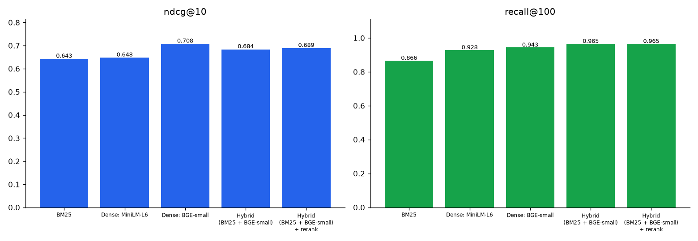
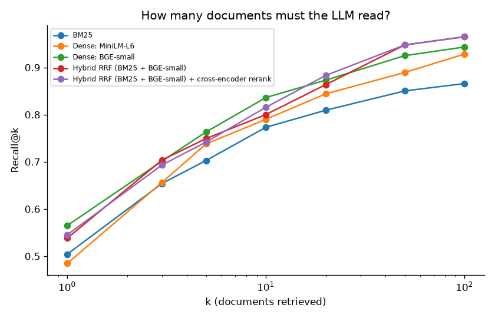
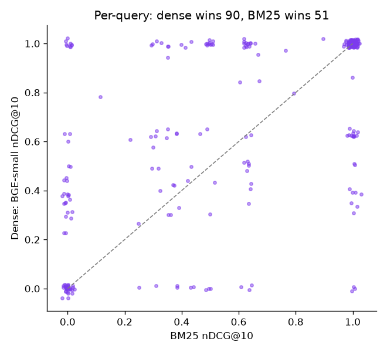

# RAG Retrieval Evaluation — BM25 vs Dense vs Hybrid vs Re-ranking


 

In a RAG system the LLM can only be as good as the documents it is given. This project measures the
**retrieval** half properly: five retrieval strategies, evaluated with standard IR metrics on
**BEIR SciFact** (5,183 scientific abstracts, 300 expert-written claims with relevance judgements) —
plus a FastAPI service that searches the corpus and returns answers with citations.

| Retriever | Idea |
|---|---|
| BM25 | Classic keyword ranking (the baseline every RAG system should beat) |
| Dense: MiniLM-L6 | General-purpose sentence embeddings |
| Dense: BGE-small | Retrieval-tuned embeddings (with query instruction) |
| Hybrid RRF | BM25 + BGE combined with reciprocal rank fusion |
| Hybrid + cross-encoder | Hybrid top-50 re-scored by `ms-marco-MiniLM-L-6-v2` |

## Results (300 test queries)

| Retriever | nDCG@10 | MRR@10 | Recall@10 | Recall@100 | CPU latency / query |
|---|---|---|---|---|---|
| BM25 | 0.643 | 0.607 | 0.773 | 0.866 | 9 ms |
| Dense: MiniLM-L6 | 0.648 | 0.606 | 0.790 | 0.928 | 5 ms* |
| **Dense: BGE-small** | **0.708** | **0.676** | **0.836** | 0.943 | 12 ms* |
| Hybrid RRF (BM25 + BGE) | 0.684 | 0.650 | 0.800 | **0.965** | 21 ms* |
| Hybrid + cross-encoder rerank | 0.689 | 0.657 | 0.816 | **0.965** | 5,200 ms |

\*Batched query encoding; excludes the one-off corpus indexing (BGE: ~14 min on CPU for 5k abstracts).



### Key findings
1. **The right embedding model matters more than the technique.** Retrieval-tuned BGE-small beats BM25 by
   **+0.065 nDCG@10 (95% paired-bootstrap CI: +0.027 to +0.101)**, while a general-purpose MiniLM is no better
   than BM25 at the top of the ranking.
2. **Hybrid search is the best choice for recall — which is what RAG needs.** Fusing BM25 with BGE cuts the share
   of relevant documents missed in the top 100 from **13.4% (BM25) to 3.5%**, almost 4× fewer misses. If the LLM
   reads 20–50 passages, hybrid retrieval gives it the most complete evidence.
3. **Keyword and semantic search fail on different queries.** Per query, BGE wins on 90 claims and BM25 on 51
   (159 ties) — exactly why fusing them helps recall.
4. **An off-the-shelf re-ranker is not a free win.** The MS MARCO cross-encoder (trained on web search) added only
   +0.005 nDCG@10 over hybrid, still trailed BGE alone, and was **~240× slower** on CPU. A domain mismatch
   (web queries vs scientific claims) makes it a poor trade here; a re-ranker would need to be domain-adapted to earn its cost.



**Practical recommendation:** BGE-small alone when the LLM reads only the top ~5 passages; hybrid RRF when it reads
20+; skip the generic cross-encoder.



## The API
```bash
uvicorn api.main:app            # http://localhost:8000/docs
curl "localhost:8000/search?q=vitamin+D+reduces+fracture+risk&k=5&method=hybrid"
curl "localhost:8000/answer?q=does+vitamin+D+reduce+fracture+risk"
```
`/answer` retrieves with hybrid search and returns an answer with `[doc_id]` citations. With `ANTHROPIC_API_KEY`
set it asks Claude to write a grounded answer that cites its sources; without it, it falls back to an extractive
answer (best-matching sentences), so the service always works. Set `RAG_ENCODER=hashing` for a dependency-free demo.

## How it works
- **One retriever interface** (`search(queries, k) -> ranked ids`) so sparse, dense, hybrid and re-ranking stages compose.
- **Metrics implemented from scratch** with BEIR/trec_eval definitions (nDCG@10 with graded relevance, MRR, Recall@k)
  and unit-tested against hand-computed values.
- **Paired bootstrap** over queries for the significance of the BGE-vs-BM25 difference.
- **Offline tests** use a hashing encoder and a stub cross-encoder, so CI never downloads a model; the `Benchmark`
  workflow runs the real experiment on GitHub Actions and commits `reports/`.

## Run it
```bash
pip install torch --index-url https://download.pytorch.org/whl/cpu
pip install -r requirements-dev.txt && pip install -e .
pytest -q                        # 9 offline tests
python -m ragbench.experiment    # full benchmark (~40 min on CPU)
```

## Data
[BEIR SciFact](https://github.com/beir-cellar/beir) (Wadden et al., 2020; Thakur et al., 2021) — downloaded automatically.
